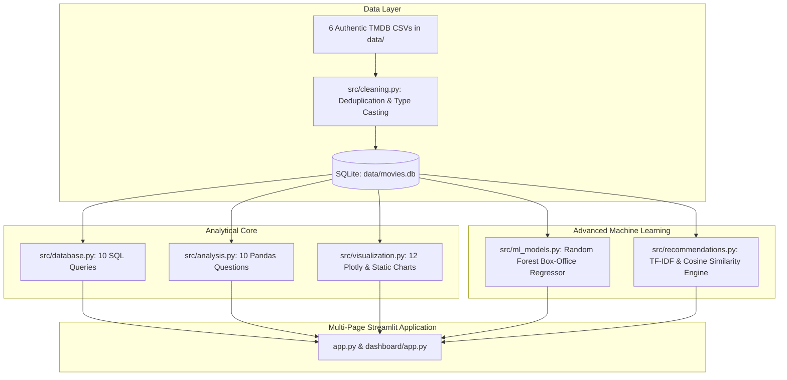

# 🎬 Reel Insights: An End-to-End Exploratory Data Analysis of the Global Movie Industry (TMDB)

An end-to-end media and entertainment analytics platform providing exploratory data analysis, relational SQL modeling, box-office econometrics, and predictive machine learning on ~2,500 movies from The Movie Database (TMDB). Built with **Python (Pandas, NumPy)**, **SQLite**, **Plotly**, **Matplotlib**, **Seaborn**, **Scikit-Learn**, and an interactive multi-page **Streamlit** dashboard.

---

## 🏗️ System Architecture



---

## 📁 Repository Structure

```
ReelInsights/
│
├── data/
│   ├── movies.csv             # Raw movie catalog (~2,500 records)
│   ├── genres.csv             # Genre master lookup (19 genres)
│   ├── movie_genres.csv       # Many-to-many bridge table (~6,800 pairs)
│   ├── cast.csv               # Top 10 billed actors per film (~24,900 rows)
│   ├── crew.csv               # Directors and writers (~7,200 rows)
│   ├── movie_keywords.csv     # Thematic metadata tags (~41,600 rows)
│   └── movies.db              # Normalized SQLite database with PKs, FKs & indexes
│
├── notebooks/
│   ├── 01_data_cleaning.ipynb # Auditing, schema setup & SQLite seeding
│   ├── 02_sql_analysis.ipynb  # Solutions to all 10 SQL project questions with insights
│   ├── 03_pandas_analysis.ipynb # Solutions to all 10 Pandas questions with insights
│   └── 04_visualizations.ipynb  # 12 Univariate, Bivariate, and Multivariate charts
│
├── src/
│   ├── __init__.py            # Central package exports
│   ├── config.py              # Centralized configuration, paths & structured logging
│   ├── cleaning.py            # Deduplication, type casting & financial 0 masking
│   ├── database.py            # Relational SQLite schema, indexes & 10 SQL engines
│   ├── analysis.py            # 10 Pandas analytical questions & KPI computation engine
│   ├── visualization.py       # 12 publication-grade Plotly visualization generators
│   ├── ml_models.py           # Box-office revenue & rating predictive machine learning
│   └── recommendations.py     # Content-based movie recommendation & similarity engine
│
├── dashboard/
│   └── app.py                 # Multi-page cinematic Streamlit web application
│
├── tests/
│   ├── test_cleaning.py       # Cleaning, deduplication & ROI tests
│   ├── test_database.py       # Foreign keys, 10 SQL questions & security tests
│   ├── test_analysis.py       # 10 Pandas analytical tests
│   └── test_ml_models.py      # ML model training, feature leakage & similarity tests
│
├── models/                    # Serialized machine learning models & vectorizers
├── logs/                      # Application runtime execution logs
├── app.py                     # Root submission entry point
├── requirements.txt           # Project dependencies
├── FINAL_AUDIT_REPORT.md      # Strict technical audit & verification report
└── README.md                  # Executive overview & documentation
```

---

## ⚡ Quick Start Guide

### 1. Environment Setup
Clone the repository and install the required dependencies:
```bash
python -m pip install -r requirements.txt
```

### 2. Initialize Database & Run Automated Tests
Seed the SQLite database and run the 29-test automated suite:
```bash
# Seed database
python -m src.database

# Execute test suite (Target: 100% passing)
python -m pytest tests -v
```

### 3. Launch the Multi-Page Streamlit Dashboard
```bash
# Option A: Standard submission launch
python -m streamlit run app.py

# Option B: Direct dashboard folder launch
python -m streamlit run dashboard/app.py
```
Open [http://localhost:8501](http://localhost:8501) in your browser.

---

## 🖥️ Streamlit Multi-Page Architecture

In accordance with the project specification, the Streamlit app implements a **three-page architecture** operating on the underlying SQLite database:

### Page 1 — Filters
* **Persistent Sidebar & Dedicated Page:** Configurable multi-genre filter, release-year range slider, minimum audience rating slider, and original language selector.
* **State Management:** Filter values are stored in `st.session_state` so they persist and apply consistently across the Dashboard and Query Explorer pages.
* **Live Match Indicator:** Real-time counter and progress bar showing the exact count and percentage of matching movies (e.g. `2,503 of 2,503 films (100.0%)`).
* **Catalog Slicer Preview:** Interactive tabular view of all matching movies with search and sorting capabilities.

### Page 2 — Dashboard
* **4 Core KPI Cards (`st.metric`):**
  1. Total Movies in active selection
  2. Total Genres represented
  3. Total Actors credited
  4. Average Audience Rating
* **Top 10 Movies by Revenue:** Stacked bar chart breaking down Production Budget vs Net Profit.
* **Genre Volume Distribution:** Interactive donut chart depicting the distribution of movies across genres.
* **Budget vs Revenue Scatter Plot:** Bivariate scatter plot with an OLS trendline and a 1x Breakeven reference line ($y = x$).
* **Filtered View Summary Insight:** Dynamic text banner highlighting the highest-grossing genre and cumulative box office for the active slice.
* **Deep-Dive Analytics Tabs:**
  - *Overview & Trajectory:* Historical annual release volume curve.
  - *Movie Intelligence:* Search, metadata drilldown, and head-to-head movie comparison matrix.
  - *Genre Intelligence:* Average revenue by genre, average rating by genre, and a decadal revenue pivot heatmap.
  - *Financial Econometrics:* Reporting coverage diagnostics, budget outliers, and multi-attribute correlation heatmap.
  - *Cast & Crew Talent:* Top prolific actors, director box-office rankings, Christopher Nolan collaborator network, and actor filmography search.
  - *Predictive Forecaster & Recommender:* Interactive Random Forest revenue simulator and content-based recommendation engine.

### Page 3 — Query Explorer
* **Dropdown Selection:** All 10 SQL specification questions accessible via an interactive dropdown.
* **SQL Terminal:** Syntax-highlighted view of the exact SQL query executed.
* **Query Results (`st.dataframe`):** Paginated, sortable view of database execution output.
* **Interactive Visualization:** Dedicated Plotly chart specifically tailored to each query's output.
* **CSV Data Export:** One-click download button for offline analysis.
* **Business Insight Box:** Concise executive takeaway explaining the practical industry implication of the query result.

---

## 🔍 SQL Analysis — 10 Questions Verification

All 10 queries execute directly against `data/movies.db`:
1. **Q1 — Action Movies Released After 2015:** 268 records (`title`, `release_date`).
2. **Q2 — Top 10 Highest-Grossing Movies with Concatenated Genres:** 10 records (*Avatar*, *Avengers: Endgame*, *Avatar: The Way of Water*, *Titanic*, *Star Wars: The Force Awakens*, etc.).
3. **Q3 — Average Budget and Revenue by Genre:** 19 genres sorted by descending revenue (Animation leads with $\$229.6\text{M}$ avg, Adventure with $\$204.6\text{M}$).
4. **Q4 — Top 10 Most Frequent Actors:** Samuel L. Jackson (34 films), Robert De Niro (30 films), Bruce Willis (28 films).
5. **Q5 — Directors with >3 Movies:** 217 directors (Steven Spielberg leads with 23 movies, Ridley Scott with 16).
6. **Q6 — Top 10 Thematic Keywords:** *independent film* (305 films), *woman director* (255 films), *murder* (243 films).
7. **Q7 — High-Budget, Below-Average Revenue Disappointments:** 273 movies with budget $> \$53.75\text{M}$ and revenue $< \$223.28\text{M}$ (computed strictly on distinct movies to eliminate multi-genre double counting).
8. **Q8 — Actors Who Worked with Christopher Nolan:** 84 unique actors (*Christian Bale*, *Michael Caine*, *Cillian Murphy*, *Tom Hardy*, etc.).
9. **Q9 — Highest-Rated Genre with $\ge 20$ Movies:** **Animation** with 137 movies and an average rating of **6.66 / 10**.
10. **Q10 — Top 10 Movies with Most Thematic Keywords:** *JFK* (102 keywords), *The Wolf of Wall Street* (62 keywords), *Casino* (58 keywords).

---

## 🧪 Pandas Analysis — 10 Questions Verification

1. **P1 (Entity Counts):** 2,503 movies, 19 genres, 11,300 cast members, 2,848 crew members.
2. **P2 (Missing/Zero Financials Audit):** 90 zero budgets, 102 zero revenues, 59 both zero; 133 distinct movies with incomplete financials handled via boolean masking ($NaN$).
3. **P3 (Net Profit & ROI):** Accurately computed on all 2,370 films with valid $(>0)$ financials.
4. **P4 (Top 15 ROI with Budget $\ge \$1\text{M}$):** *Dragon Ball Super: Broly* (12,400% ROI), *Snow White and the Seven Dwarfs* (12,324%), *The Rocky Horror Picture Show* (12,127%), *Rocky* (11,625%).
5. **P5 (Annual Releases & Peak):** Peak production year is **2016** with **121 releases**.
6. **P6 (Statistical Runtime Outliers via $1.5 \times IQR$):** $Q_1=97.0$, $Q_3=123.0$, $IQR=26.0$. Lower bound = 58.0 min, upper bound = 162.0 min. Exactly **60 outliers** identified.
7. **P7 (Primary Genre Average Popularity):** 19 primary genres evaluated; Adventure and Action lead average popularity.
8. **P8 (Top 10 Prolific Actors & Ratings):** Evaluated mean ratings for top 10 actors; Samuel L. Jackson averages 6.64 across 34 films.
9. **P9 (Duplicate Title Disambiguation):** Identified 100 entries sharing titles across distinct release years (distinguishing remakes from duplicate rows).
10. **P10 (Popularity vs. Vote Count Divergence):** Top 15 divergence titles identified where recency and algorithmic popularity diverged from historical vote tallies.

---

## 💡 Top 5 Strategic Business Insights & Recommendations

1. **Asymmetrical ROI in Mid-to-Low Budget Tiers:**
   - *Finding:* While blockbuster tentpoles ($>\$150\text{M}$) capture the highest gross revenues, their ROI is constrained (150%–300%). Conversely, breakout films with budgets between $\$1\text{M}$ and $\$20\text{M}$ consistently yield exponential returns exceeding 1,000%–10,000%.
   - *Recommendation:* Studio planners should balance tentpole investments with a disciplined pipeline of low-to-mid budget high-concept productions to maximize capital efficiency.
2. **Genre Divergence of Profit vs. Prestige:**
   - *Finding:* **Animation** and **Adventure** generate the highest average revenues ($>\$200\text{M}$ avg), while **History** and **Drama** command the highest audience ratings ($>7.2/10$) despite modest commercial yields. **Horror** achieves the lowest average audience ratings ($\approx 6.0/10$) yet boasts the highest success-to-investment profitability margin.
   - *Recommendation:* Greenlighting criteria must match genre economics—wide theatrical distribution for spectacle adventure vs. targeted platform releases and awards campaigns for prestige dramas.
3. **Talent Packaging & Repeat Director Collaborations:**
   - *Finding:* Prolific directors with more than 3 catalog films demonstrate proven commercial repeat rates. Furthermore, auteur directors (e.g. Christopher Nolan) consistently employ a core ensemble troupe, correlating with lower critical volatility and higher baseline global audience retention.
   - *Recommendation:* Talent packaging should leverage historically proven director-cast synergies to de-risk major capital investments during pre-production greenlight reviews.
4. **The Pitfall of High-Budget Disappointments ($>\$100\text{M}$ Traps):**
   - *Finding:* Over 270 films in the dataset generated above-average production budgets while delivering below-average box-office revenues, driven by escalating CGI costs without clear audience differentiation.
   - *Recommendation:* Implement strict mid-production gate-keeping and pre-visualization budgeting on projects exceeding $\$80\text{M}$. Prioritize narrative distinctiveness over visual effects overhead.
5. **Algorithmic Popularity vs. Audience Retention Divergence:**
   - *Finding:* TMDB popularity scores frequently exhibit short-term divergence from total vote counts. Highly marketed contemporary franchise releases experience sharp spikes in popularity that decay rapidly, whereas evergreen legacy classics maintain high vote counts and steady engagement decades post-release.
   - *Recommendation:* Streaming content acquisition executives should distinguish between transient viral buzz and long-term catalogue value when licensing content.

---

## 📜 Academic & Corporate Accreditation
Developed in compliance with the **HCL GUVI Senior Data Analytics & Engineering Specialization** project guidelines.
